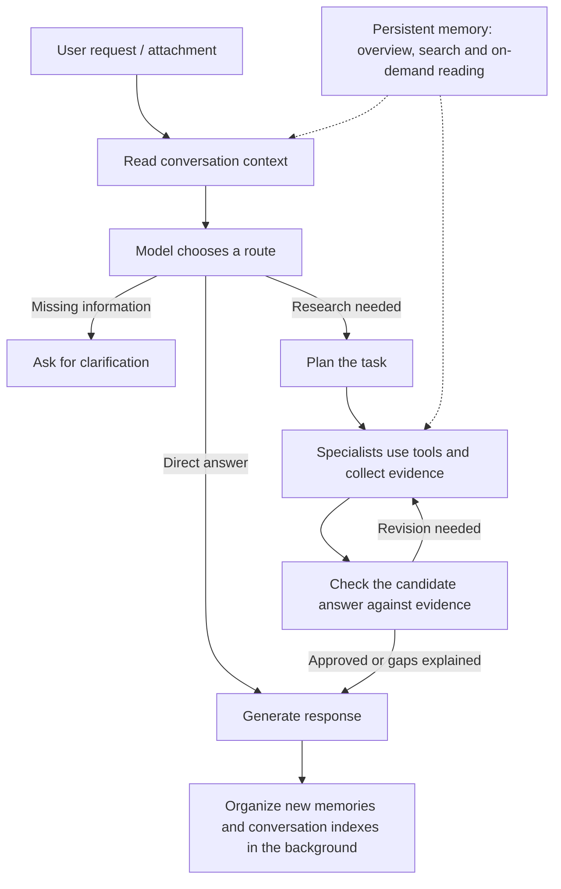

# ToyAgent

ToyAgent is an AI agent that I built to bring conversation, web research, file analysis, and persistent memory into one interactive workspace. It assesses each request and decides whether to answer directly, ask for clarification, or run a research workflow with tools and evidence verification.

The project focuses on the full interaction: understanding context, choosing tools, checking evidence, showing progress, and reporting which stage failed when something goes wrong.

## Features

- **Multi-model chat:** Configure your own OpenAI and DeepSeek API keys and choose an available model and reasoning level in the interface.
- **Research and verification:** Plan research tasks, search and read web pages, collect evidence, and check whether a proposed answer is supported by that evidence.
- **File analysis:** Upload files and ask follow-up questions about them. PDFs can be analyzed; visual and file capabilities depend on the selected provider and model.
- **Persistent memory:** Retain useful background, preferences, and project context across conversations. OpenAI and DeepSeek conversations can use the same local account's memories.
- **Memory controls:** View, edit, delete, or permanently forget memories; pause memory or use temporary mode when needed.
- **Conversation context:** Retain conversation history and attachment references so follow-up questions can relate to earlier content.
- **Interactive workspace:** Switch between Chinese and English, read Markdown and mathematical notation, see generation and research progress, and switch conversations while another response is being generated.
- **Error feedback:** Show the stage and safe diagnostic details to help identify model or tool failures.

Tool availability, file support, and context limits depend on the selected model and configuration. Model and search calls may incur charges.

## How it works



1. **Understand the request:** An entry-point model uses the current request and conversation context to choose a direct answer, clarification, or research. Ordinary conversation does not need the full research workflow.
2. **Research when needed:** LangGraph coordinates the research workflow. A planner breaks down the task, and lookup, computation, file, or visual specialists handle the relevant steps. Tool access and calls are bounded by permissions and budgets.
3. **Verify and deliver:** A critic checks candidate answers and supporting evidence. The system may attempt a correction or explain what it could not establish. The interface shows generation and research progress, and identifies research drafts before verification.
4. **Organize in the background:** After an answer is delivered, the system can update conversation indexes and extract information worth remembering. A memory-maintenance failure does not replace or erase the delivered answer.

Research, verification, and recovery have time and call budgets. The agent can still encounter insufficient sources, service errors, or tasks it cannot complete.

## Memory

ToyAgent separates the current conversation from persistent memory:

- **Conversation context** includes messages, conversation indexes, and attachment references. Follow-up questions can retrieve relevant earlier information or files without putting all history into every model request.
- **Persistent memory** stores potentially useful long-term background, preferences, and project facts. Background jobs extract and organize information and maintain topic summaries and indexes.
- **On-demand retrieval:** The model can decide whether to search memory and continue reading relevant facts when needed. Summaries help navigate the memory store; they should not replace the underlying facts and their provenance.
- **User control:** Memories can be viewed, edited, deleted, paused, or permanently forgotten. Ordinary deletion and permanent forgetting behave differently; see the [local guide](docs/local-self-hosting.md) for details.

There is no fixed account-wide limit on the number of saved memory entries, although disk space, individual retrieval operations, and model context remain bounded. Automatic extraction and organization may incur additional model charges. Memory is supporting context and is not guaranteed to be complete or always correct; current requests and external facts may require separate verification.

## Run locally

The repository includes a **single-user, local Docker demo**. No sign-in or access password is required. Each user configures their own provider API key.

### Prerequisites

- Git.
- A running Docker Desktop or Docker Engine installation with Docker Compose v2. A recent Docker Desktop is recommended for Compose volume subpath support.
- macOS or Linux. On Windows, run the commands below in WSL2.
- An OpenAI or DeepSeek API key. Additional search providers can be configured if needed.

The first build requires an internet connection and sufficient disk space. Model, search, and other provider charges are billed to your own accounts.

### First launch

```bash
git clone https://github.com/Oliver-Fang521/ToyAgent.git
cd ToyAgent

cp .env.local.example .env.local
docker compose --env-file .env.local up -d --build --wait
```

The first launch generates local runtime secrets automatically. Once the services are ready:

1. Open [http://localhost:3000](http://localhost:3000).
2. Open **Settings** and configure your OpenAI or DeepSeek API key. Add search-provider keys if you want to use them.
3. Choose a model and start a conversation.

The local service binds to `localhost`. If port 3000 is in use, change `TOYAGENT_PORT` in `.env.local` and open `http://localhost:<port>`. Use `localhost`: the application checks the configured access address.

### Everyday commands

Run these commands from the project directory:

```bash
# Start an existing installation
docker compose --env-file .env.local up -d --wait

# Check service status or follow logs
docker compose --env-file .env.local ps
docker compose --env-file .env.local logs -f frontend backend

# Stop while preserving data
docker compose --env-file .env.local down
```

`down` preserves the data volumes. **Do not casually run `down -v`:** it removes the volumes containing conversations, memories, and secrets. For upgrades, backups, recovery, and troubleshooting, see the [local guide](docs/local-self-hosting.md).

### Deployment boundary

The local demo has no access password and is intended for your own computer. Someone with access to the computer or local service may be able to access its data. Do not expose this configuration directly to the public internet. A public multi-user deployment requires separate authentication, account isolation, security review, and operations work.

## Project structure

```text
ToyAgent/
├── sites/agent-web/              # Web workspace: chat, model settings, memory
├── src/gaia_agent/
│   ├── interactive/              # Web API, conversations, credentials, memory, events
│   ├── agents.py                 # Planner, specialists, and critic
│   ├── orchestrator.py           # LangGraph workflow and budget controls
│   ├── mcp_server.py             # Tool server
│   ├── search.py                 # Search providers and fallback
│   └── providers/                # Model-provider adapters
├── deploy/                       # Docker images, local runtime, and backup tools
├── docs/                         # Deployment and design documentation
├── tests/                        # Unit, integration, and end-to-end tests
└── compose.yaml                  # Local container orchestration
```

Some internal Python packages and historical evaluation files retain the name `gaia_agent` from an earlier stage of the project. The interactive agent is called **ToyAgent**.

## Tests

Install the Python development dependencies and run:

```bash
uv sync --frozen
uv run pytest
```

Some integration tests require Docker or a local network port. Passing tests demonstrate the covered scenarios; they do not guarantee success for every model, external service, or user task. The repository also retains earlier evaluation code for research and regression testing; ToyAgent is not limited to a benchmark.
