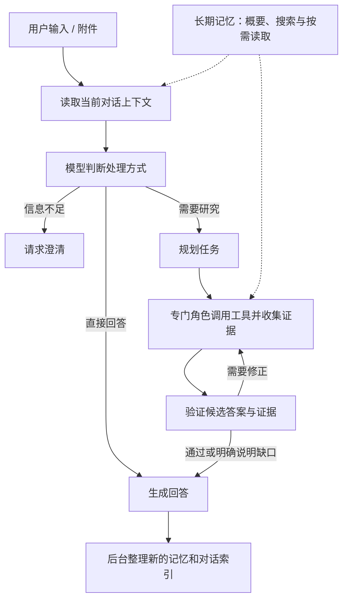

# ToyAgent

ToyAgent 是我独立开发的多模型 AI Agent。它把聊天、联网研究、文件分析和跨对话记忆放在一个网页工作台中：用户提出问题后，Agent 根据问题决定直接回答、询问缺少的信息，或进入使用工具和验证证据的研究流程。

这个项目的重点是让 Agent 在真实交互中完成一项任务：理解上下文、选择工具、检查证据、展示进度，并在出现问题时告诉用户出错的阶段。

## 功能

- **多模型对话**：支持配置 OpenAI 和 DeepSeek API Key，在界面中选择可用模型和推理等级。
- **研究与事实核验**：针对需要外部资料的问题制定计划，搜索和读取网页，整理证据，再检查答案与证据是否一致。
- **文件分析**：上传文件并围绕文件继续提问；PDF 可用于分析，具体视觉与文件能力取决于所选服务商和模型。
- **跨对话记忆**：记住有长期价值的用户背景、偏好和项目上下文；同一本地账户的 OpenAI 和 DeepSeek 对话可以使用共享记忆。
- **可控的记忆管理**：在界面中查看、修改、删除或永久遗忘记忆，也可以暂停记忆或使用临时模式。
- **对话上下文**：保留对话历史及附件引用，帮助后续问题关联之前的内容。
- **交互式工作台**：支持中英文界面、Markdown 和公式显示、生成进度提示，以及生成过程中切换对话。
- **可观察的错误反馈**：展示任务所处阶段和安全的错误信息，辅助排查模型或工具调用问题。

工具可用性、文件能力和模型上下文长度随所选模型及配置变化。调用模型或搜索服务可能产生费用。

## 工作流程



1. **理解问题**：入口模型结合当前请求和对话上下文，选择直接回答、澄清或研究。普通聊天不必经过完整研究流程。
2. **按需研究**：研究流程由 LangGraph 编排。规划角色拆分任务，由对应的查找、计算、文件或视觉角色处理；工具调用受到权限和预算限制。
3. **检查与交付**：验证角色检查候选答案及证据，必要时尝试修正或说明缺口。前端展示生成内容和研究进度；研究草稿在验证前会标明状态。
4. **后台整理**：回答交付后，系统可以整理对话索引及值得长期保存的信息。失败的记忆整理不会替代或抹去已交付的回答。

研究流程中的工具、验证和修复均受时间及调用预算约束；Agent 仍可能遇到来源不足、服务错误或无法完成的任务。

## 记忆如何工作

ToyAgent 区分当前对话上下文和长期记忆：

- **对话上下文**包含当前聊天中的消息、整理后的索引以及附件引用。后续提问可以重新查找相关对话内容或文件，不需要把所有历史内容反复放进模型上下文。
- **长期记忆**用于保存长期有用的背景、偏好和项目事实。系统在后台提取和整理相关信息，并为主题建立摘要和索引。
- **按需检索**：模型可以根据当前问题决定是否搜索记忆，并在需要时继续读取相关事实；摘要是查找入口，不应替代事实及其来源。
- **用户控制**：记忆可以查看、编辑、删除、暂停或永久遗忘。普通删除与永久遗忘的行为不同，具体说明见[本地使用指南](docs/local-self-hosting.md)。

保存的记忆条目没有固定的账户总数上限，但磁盘空间、单次检索范围和模型上下文仍有实际限制。自动提取和整理可能产生额外的模型调用费用。记忆是辅助上下文，不保证完整或永远正确；当前请求和需要实时验证的外部事实仍需要单独处理。

## 本地运行

本项目提供**单用户、本机 Docker Demo**。无需登录或设置访问密码；每位使用者自行配置模型服务商的 API Key。

### 准备

- Git。
- 已启动的 Docker Desktop 或 Docker Engine，以及 Docker Compose v2。建议使用较新的 Docker Desktop，以支持 Compose volume subpath。
- macOS 或 Linux；Windows 用户可以在 WSL2 中运行以下命令。
- 可用的 OpenAI 或 DeepSeek API Key。搜索服务可按需要另行配置。

首次构建需要网络连接和足够的磁盘空间。模型、搜索等费用由你自己的服务商账户承担。

### 第一次启动

```bash
git clone https://github.com/Oliver-Fang521/toy_multi_agent.git
cd toy_multi_agent

cp .env.local.example .env.local
docker compose --env-file .env.local up -d --build --wait
```

首次启动会自动生成本地运行密钥。启动完成后：

1. 打开 [http://localhost:3000](http://localhost:3000)。
2. 打开**设置**，配置自己的 OpenAI 或 DeepSeek API Key；如需备用搜索服务，也可以填写对应的 Key。
3. 选择模型，开始对话。

本地配置只绑定当前电脑的 `localhost`。如果 3000 端口被占用，可以修改 `.env.local` 中的 `TOYAGENT_PORT`，然后使用相应的 `http://localhost:端口`。请使用 `localhost`，应用会检查配置的访问地址。

### 日常使用

在项目目录启动、查看日志或停止：

```bash
# 启动已有安装
docker compose --env-file .env.local up -d --wait

# 查看状态或日志
docker compose --env-file .env.local ps
docker compose --env-file .env.local logs -f frontend backend

# 停止，保留数据
docker compose --env-file .env.local down
```

`down` 会保留数据卷；**不要随意使用 `down -v`**，它会删除聊天、记忆和密钥数据。升级、备份、恢复与故障排查见[本地使用指南](docs/local-self-hosting.md)。

### 使用边界

本地 Demo 没有访问密码，只适合自己的电脑；能够使用该电脑或访问本地服务的人可能看到数据。请不要直接将本地服务开放到公网。公网多人使用需要另外完成身份认证、账户隔离、安全审查及运维部署。

## 项目结构

```text
ToyAgent/
├── sites/agent-web/              # 网页工作台：对话、模型设置、记忆管理
├── src/gaia_agent/
│   ├── interactive/              # Web API、对话、凭证、记忆和流式事件
│   ├── agents.py                 # 规划、专门角色及验证角色
│   ├── orchestrator.py           # LangGraph 任务流程与预算控制
│   ├── mcp_server.py             # 工具服务
│   ├── search.py                 # 搜索服务与回退
│   └── providers/                # 模型服务商适配
├── deploy/                       # Docker 镜像及本地运行、备份工具
├── docs/                         # 部署与设计文档
├── tests/                        # 单元、集成和端到端测试
└── compose.yaml                  # 本地容器编排
```

部分内部 Python 包和历史评测文件仍沿用 `gaia_agent` 名称；它们是项目演进中保留的实现路径，网页产品名称是 **ToyAgent**。

## 测试

安装 Python 开发依赖后运行：

```bash
uv sync --frozen
uv run pytest
```

部分集成测试需要 Docker 或本地网络端口。测试通过只能说明覆盖到的场景正常，不能保证所有模型、外部服务及用户任务都成功。代码仓库也保留了一些早期评测相关内容，用于研究和回归，不代表 ToyAgent 的用途局限于某个 benchmark。
